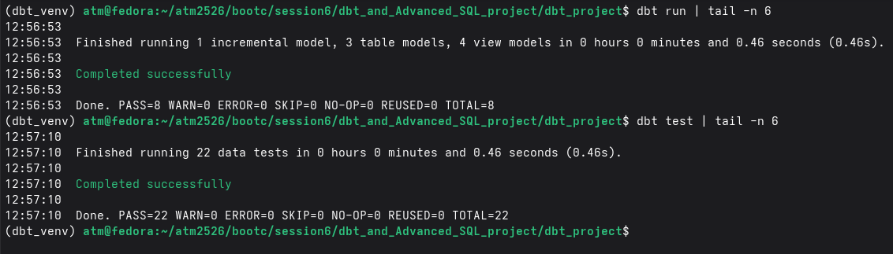
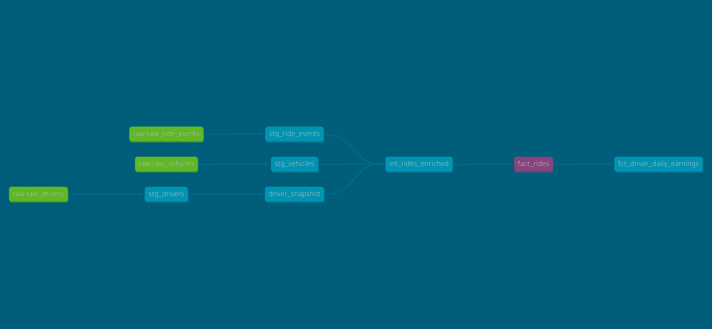
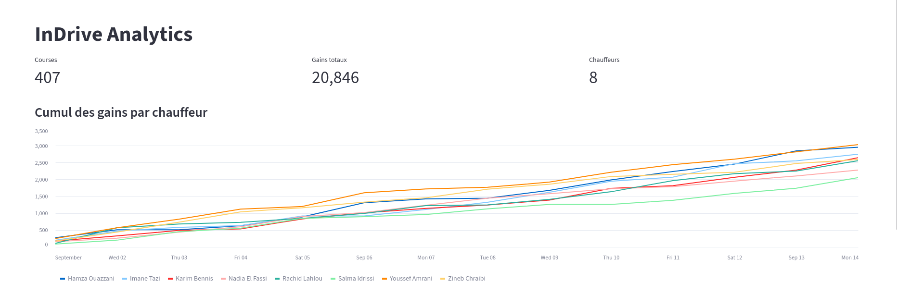
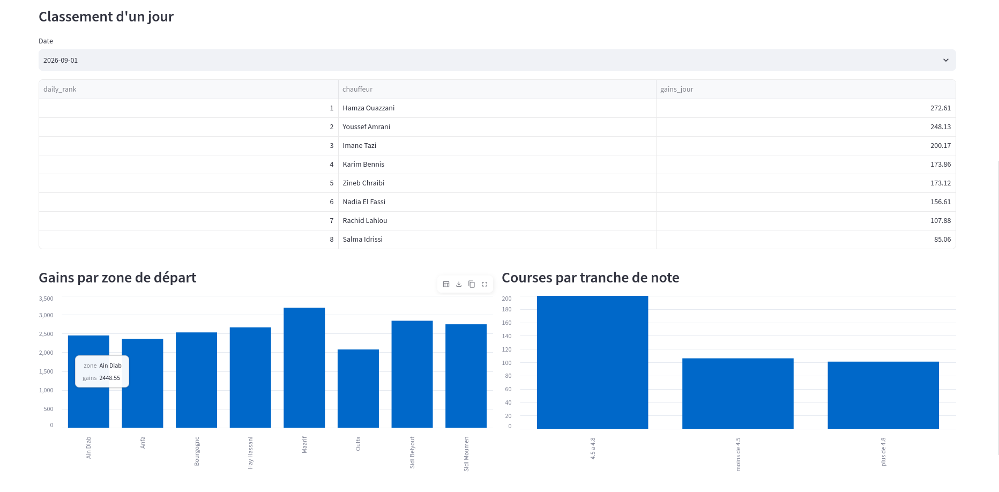

# InDrive Analytics avec dbt

Ce projet transforme les données brutes d'une application de VTC (InDrive) en un star schema dans PostgreSQL, avec dbt. Les modèles sont testés et documentés, et le projet utilise les principaux outils de dbt : sources, snapshot, modèle incrémental, macro, variable et window functions. En bonus, un dashboard Streamlit permet de visualiser les résultats.

## Données sources et Règles métiers

Je reçois 4 fichiers CSV : 8 chauffeurs, 8 véhicules, 8 zones et 407 courses enregistrées en septembre 2026.  
Parmi les règles métiers : la note (`rating`) d'un chauffeur peut évoluer dans le temps, un véhicule est affecté à un chauffeur, et chaque course contient une zone de départ, une zone d'arrivée, une distance et un prix.  
La commande `dbt seed` charge initialement ces fichiers bruts dans le schéma `raw` de PostgreSQL, servant de point de départ au pipeline de transformation.

## Architecture du Pipeline de Données

Le pipeline de données est structuré en couches successives (Staging, Intermediate, Marts), respectant la méthodologie de modélisation en étoile (_Star Schema_).

### 1. Couche Staging (Extraction et Nettoyage)

Cette couche isole les tables sources au travers de quatre vues (`stg_drivers`, `stg_vehicles`, `stg_zones`, `stg_ride_events`). Son rôle se limite exclusivement au renommage uniforme des champs et au transtypage (_casting_) des données. La vue `stg_ride_events` intègre un filtrage dynamique basé sur la variable globale `start_date` configurée dans le fichier `dbt_project.yml`.

### 2. Modélisation en Étoile (Marts & Dimensions)

L'entrepôt est structuré autour d'une table de faits centrale et de ses dimensions :

- **`fact_rides` (Table de Faits) :** Positionnée au centre du schéma, elle adopte un grain d'une ligne par course. C'est un modèle **incrémental** (stratégie _merge_) qui traite uniquement les nouveaux enregistrements à chaque exécution.
- **`dim_vehicle` & `dim_zone` (SCD Type 1) :** Dimensions classiques ne nécessitant pas de conservation d'historique. La table `dim_zone` intervient deux fois dans le modèle final (zone de départ et zone d'arrivée).
- **`driver_snapshot` (SCD Type 2) :** Un snapshot dbt dédié au suivi des chauffeurs, permettant de capturer et de figer chaque évolution temporelle de leur note (`rating`).

### 3. Couche Intermédiaire Éphémère

Le modèle intermédiaire `int_rides_enriched` est configuré en matérialisation `ephemeral`. Il agit comme une CTE réutilisable qui effectue les jointures entre les courses, les véhicules et la version courante de l'historique du chauffeur. C'est ici qu'est appelée la macro personnalisée `rating_bracket` pour catégoriser dynamiquement les notes en trois tranches analytiques (moins de 4.5, 4.5 à 4.8, plus de 4.8).

### 4. Couche Analytique (Marts Avancés)

Le modèle final `fct_driver_daily_earnings` exploite des fonctions de fenêtrage (_Window Functions_) pour calculer les indicateurs de performance des chauffeurs : gains quotidiens, cumul des revenus au cours du temps (_running total_) et classement quotidien des chauffeurs par chiffre d'affaires.

### 5. Qualité des Données & Tests

Le projet compte **22 tests**, lancés avec `dbt test` :

- Tests d'unicité (`unique`) et de non-nullité (`not_null`) sur toutes les clés primaires.
- Validation des domaines de valeurs (`accepted_values`) sur la colonne `vehicle_type`.
- Tests d'intégrité référentielle (`relationships`) connectant la table de faits aux dimensions des chauffeurs et des zones urbaines.

## Organisation du dossier

```text
dbt_and_Advanced_SQL_project/
├── docker-compose.yml        # Postgres + Adminer
├── README.md
├── docs/                     # captures d'écran (preuve, lignage)
└── dbt_project/
    ├── dbt_project.yml       # config + variable start_date
    ├── seeds/                # les 4 CSV bruts
    ├── models/
    │   ├── staging/          # 4 vues stg_*, sources, tests
    │   ├── intermediate/     # int_rides_enriched (éphémère)
    │   └── marts/            # dim_vehicle, dim_zone, fact_rides, fct_driver_daily_earnings
    ├── snapshots/            # driver_snapshot (SCD2 sur le rating)
    └── macros/               # rating_bracket, generate_schema_name
```

## Lancement du projet

On démarre Postgres avec Docker, puis on crée un environnement Python pour installer dbt et on branche dbt sur la base avant de tout exécuter :

```bash
docker compose up -d
python3 -m venv dbt_venv && source dbt_venv/bin/activate
pip install dbt-postgres
mkdir -p ~/.dbt && cp dbt_project/profiles.yml.example ~/.dbt/profiles.yml
cd dbt_project
dbt debug
dbt seed && dbt snapshot && dbt run && dbt test
dbt docs generate && dbt docs serve
```

Le snapshot doit passer avant `dbt run`, parce que `int_rides_enriched` lit `driver_snapshot`. Adminer (http://localhost:8082) permet de regarder les tables.

Petite remarque : `dbt source freshness` affiche une ERROR sur `raw_ride_events`, c'est normal : les courses datent de septembre 2026 et le CSV ne change pas, donc dbt les trouve périmées.

## Preuve que ça tourne

`dbt run` s'est terminé avec 8 modèles et 0 erreur, et `dbt test` avec 22 tests et 0 erreur.



## Réponses aux questions

**Q4. Grain de `fact_rides`**

Une ligne par course demandée, identifiée par son `ride_id`.

**Q5. Pourquoi le Type 1 suffit pour `dim_vehicle` et `dim_zone`**

Seule la valeur actuelle compte : personne n'a besoin de savoir comment une voiture ou un quartier était décrit avant.

**Q6. Pourquoi un snapshot pour les chauffeurs seulement**

La note d'un chauffeur change et on veut savoir laquelle il avait à un moment précis, donc il faut garder l'historique. Avec `strategy='check'` sur `rating`, dbt ferme l'ancienne ligne et en ouvre une nouvelle à chaque changement. Pour les véhicules et les zones il n'y a rien à historiser, un snapshot stockerait des versions inutiles.

**Q7. Pourquoi un LEFT JOIN**

Avec un INNER JOIN, une course dont le chauffeur n'existe pas disparaîtrait en silence avant `fact_rides`, et les tests de la partie E ne verraient rien. Avec un LEFT JOIN elle reste, avec une note vide, et `relationships` peut la repérer. J'ai aussi pris le `driver_id` sur la course et pas sur le snapshot, sinon il serait null et `relationships` ignorerait la ligne.

**Q9. Macro ou variable**

Une macro, parce qu'elle reçoit une note et renvoie du SQL (un `case when`) appliqué à chaque ligne. Une variable ne contient qu'une valeur fixe, comme `start_date`. J'ai ajouté un cas "inconnu" pour les notes nulles, sinon un chauffeur introuvable tomberait dans "plus de 4.8".

**Q10. Comportement du modèle incrémental après un changement de note**

Après avoir modifié la note d'un chauffeur de 4.80 à 3.90 et relancé `dbt snapshot`, le snapshot contient bien ses deux lignes d'historique.

Pourtant, lors d'un `dbt run` classique, ses 57 anciennes courses conservent l'ancienne note (4.80) dans `fact_rides` (le terminal affiche `MERGE 0`). C'est le comportement normal d'un modèle **incrémental** : dbt ne filtre et ne traite que les courses dont la date est strictement supérieure à la course la plus récente déjà stockée. Les données du passé ne sont donc jamais lues ni mises à jour.

Le seul moyen de corriger cela et d'appliquer la nouvelle note aux anciennes courses est d'utiliser le flag **`--full-refresh`**. Ce flag force dbt à vider la table et à reconstruire tout l'historique depuis zéro, ce qui fait passer les 57 courses à la note de 3.90.

**Q12. Quel test échoue avec un chauffeur inexistant**

Après l'insertion d'une course avec un `driver_id` inexistant (`999`), un seul test échoue : **`relationships_fact_rides_driver_id__driver_id__ref_stg_drivers_`** (FAIL 1).
Grâce au `LEFT JOIN` dans le modèle intermédiaire, la course n'est pas bloquée : elle reste présente dans `fact_rides` avec la tranche `"inconnu"`. Le test d'intégrité référentielle détecte qu'elle pointe vers un chauffeur absent de notre dimension. Tout repasse au vert après la suppression de la ligne et un `dbt run --full-refresh && dbt test`.

**Q14. `int_rides_enriched` dans le lignage**

Oui, il apparaît entre les sources et `fact_rides`, même s'il est éphémère. Le graphe se construit à partir des `ref()` et pas des tables en base. Le modèle n'a ni table ni vue, dbt l'injecte comme CTE dans `fact_rides`.



## Ce que j'en retiens

J'ai vu deux pièges en vrai : un modèle incrémental ne corrige pas son passé tout seul, et un INNER JOIN peut cacher une erreur au lieu de la faire échouer. Un test qui échoue au bon endroit rassure plus qu'un test qui passe tout le temps.

## Dashboard Streamlit

En bonus, un petit dashboard lit les marts dbt dans Postgres et affiche le cumul des gains par chauffeur, le classement d'un jour, les gains par zone de départ et les courses par tranche de note.

```bash
pip install -r streamlit_app/requirements.txt
streamlit run streamlit_app/app.py
```




